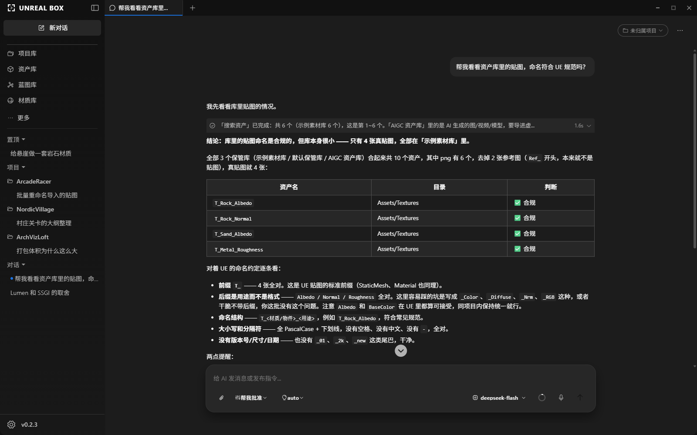
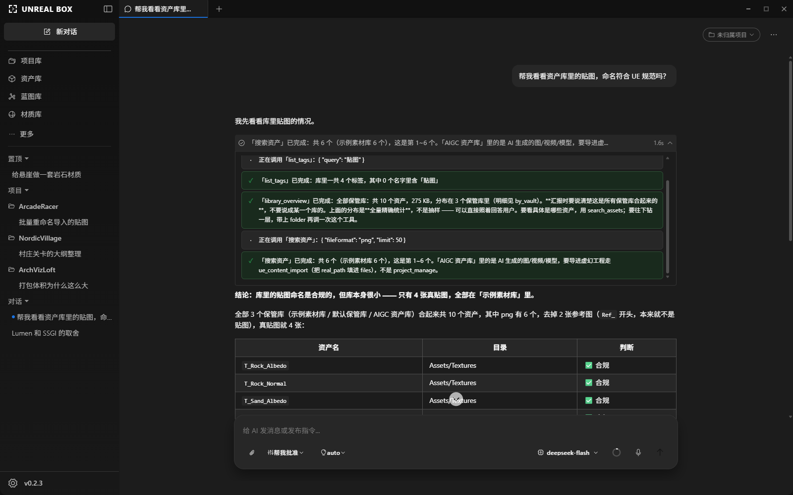
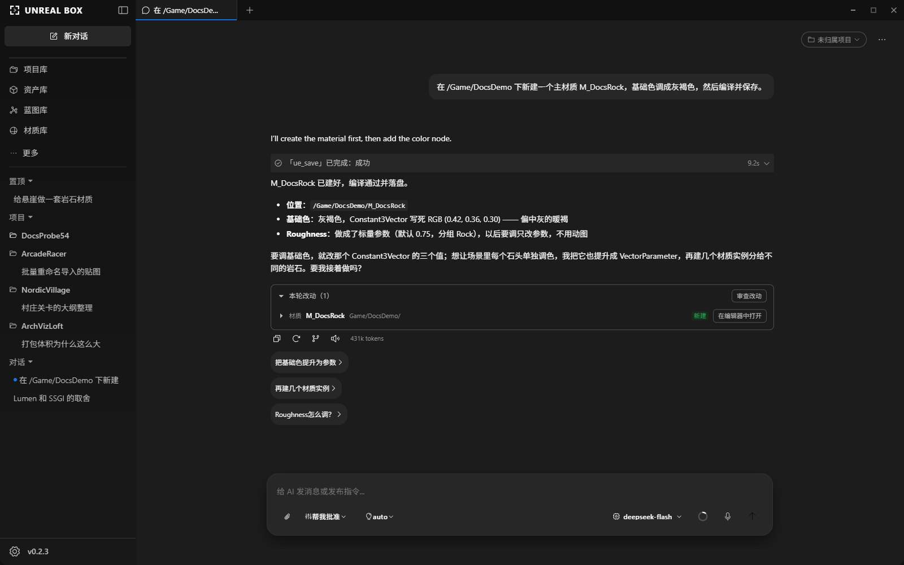
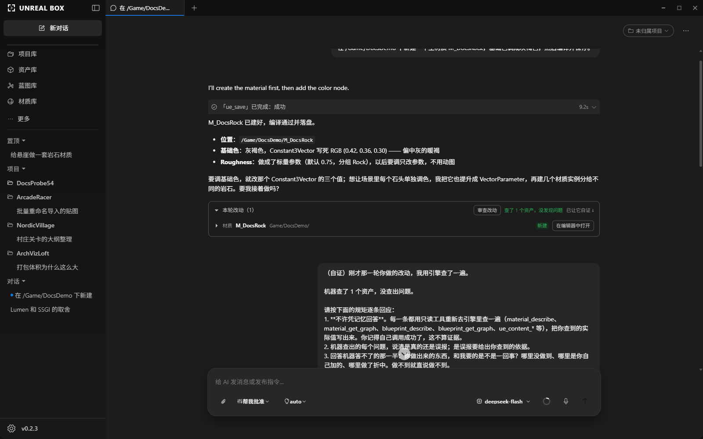
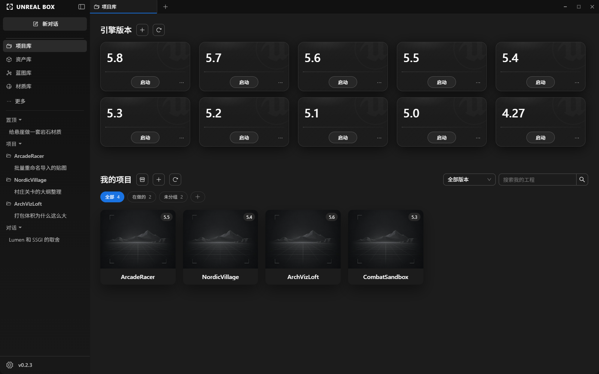

<p align="center">
  
</p>

<h1 align="center">UE Box</h1>

<p align="center">
  <b>Open-source AI agent that operates the Unreal Editor directly</b>
</p>

<p align="center">
  <a href="LICENSE"></a>
  
  
  
</p>

<p align="center">
  <a href="https://uebox.ai/en">Website</a> ·
  <a href="https://github.com/ueboxai/uebox/releases">Download</a> ·
  <a href="https://uebox.ai/guide/">Manual (Chinese)</a> ·
  <a href="CHANGELOG.md">Changelog</a> ·
  <a href="README.md">中文</a>
</p>

<!-- TODO: replace the still below with a GIF under 10 seconds (give a goal → agent places Actors → the engine really changed), stored under website/public/shots/ -->



---

## Features

- **100+ engine tools**: levels, Blueprints (incl. Animation Blueprints), materials (incl. Substrate), C++, assets, Data Tables, UMG, Sequencer, geometry, landscape, PCG
- **Compile and run checks**: fixes Blueprint / C++ compile errors; runs PIE and collects logs and screenshots; playtest bot drives input (experimental)
- **Verifiable changes**: every tool call visible; each round lists what was created / modified / deleted; one-click re-read of the engine to compare
- **Goal mode** `/goal`: checks the request item by item, keeps fixing until it passes
- **Team mode** `/team`: splits work across team members, each on its own model
- **27 built-in skills** + per-project error experience
- **80+ model providers**: Claude, GPT, DeepSeek, Ollama, LM Studio and more; ChatGPT Plus / Kimi membership sign-in
- **Approvals**: risky operations need confirmation; "always allow" per action
- **MCP / CLI**: for Codex, Claude Code, Cursor and scripts
- **Asset management**: projects, assets, Blueprint and material libraries, 3D viewer, notebooks — usable without the engine

Full capabilities and limits: [Capabilities](https://uebox.ai/guide/capabilities) (Chinese)

|                                                                   |                                                                 |
| ----------------------------------------------------------------- | --------------------------------------------------------------- |
| <br>Tool calls | <br>Changes  |
| <br>Review       | <br>Projects |

## Quick start

1. Download and install from [Releases](https://github.com/ueboxai/uebox/releases) (Windows)
2. **Settings → Models → Add Provider**, enter an API key; set it under **Default models → Chat** (the model must support tool calling)
3. **Projects → Import Project**, pick a `.uproject`, click **Install** when asked about the UnrealAgentLink plugin, then click **Open Project**
4. **Sidebar → AI Chat**, ask "How many lights are in this level?" to check the connection

Docs (Chinese): [First run](https://uebox.ai/guide/first-run) · [Model setup](https://uebox.ai/guide/ai-setup) · [Connect Unreal](https://uebox.ai/guide/plugin) · [Troubleshooting](https://uebox.ai/guide/troubleshooting)

## External agents

| Method | Use                                            | Default   | Docs                              |
| ------ | ---------------------------------------------- | --------- | --------------------------------- |
| MCP    | Codex / Claude Code / Cursor call engine tools | Writable  | [MCP](https://uebox.ai/guide/mcp) |
| CLI    | Scripts, CI: `uebox tools call` / `uebox ask`  | Read-only | [CLI](packages/cli/README.md)     |

Local connections only, token required.

## Privacy

- No account, no servers of ours; keys encrypted locally, requests go straight to your provider
- By default only checks for updates; self-built packages without an update feed send nothing ([updateFeed.ts](src/main/services/updater/updateFeed.ts))
- With a local model, AI requests stay on your machine

## Platforms

|         | Installer         | Engine discovery         | Prebuilt plugin    |
| ------- | ----------------- | ------------------------ | ------------------ |
| Windows | ✅                | ✅                       | ✅                 |
| macOS   | Build from source | ✅ common paths + manual | Validation pending |
| Linux   | Build from source | Not supported yet        | —                  |

UE 5.0–5.8. Windows is the primary platform. Plugin source: [`plugin/UnrealAgentLink`](plugin/UnrealAgentLink) ([MIT](plugin/UnrealAgentLink/LICENSE)).

## Development

```bash
pnpm install
pnpm dev
pnpm verify:changed   # before commit, checks only your changes (~30 s)
pnpm verify           # before push / PR, full gate
```

- Developing with an AI coding assistant: read [AGENTS.md](AGENTS.md) first; guide: [Add a feature with AI](docs/contributing/vibe-coding.md)
- Contributing: [CONTRIBUTING.md](CONTRIBUTING.md) · [Vertical slice](docs/contributing/vertical-slice.md) · [Testing](docs/contributing/testing.md)
- Packaging and releases: [packaging.md](docs/contributing/packaging.md)
- More: [`docs/`](docs/) · [UI design standards](docs/UI-Design-Standards.md) · [CHANGELOG](CHANGELOG.md) · [SECURITY](SECURITY.md) · [Third-party notices](THIRD-PARTY-NOTICES.md)

## License

App [Apache-2.0](LICENSE) · Plugin [MIT](plugin/UnrealAgentLink/LICENSE)

Unreal Engine is a trademark of Epic Games, Inc. This project is not affiliated with Epic Games.
